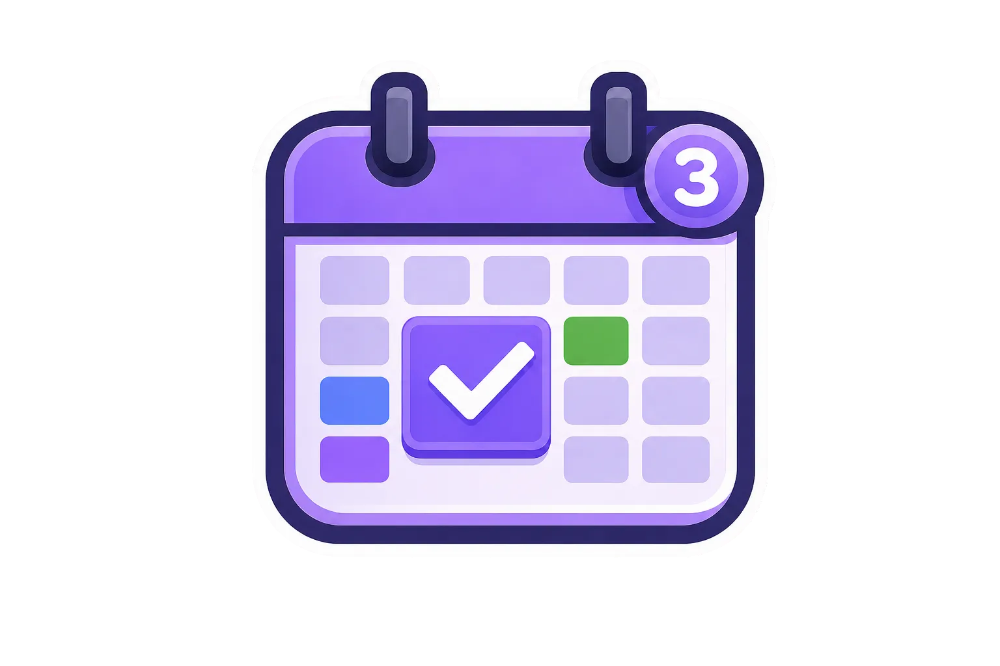

# Calendar Importer

<p align="center">
  
</p>

<p align="center">
  <a href="https://buymeacoffee.com/efficientx">
    
  </a>
</p>

<p align="center">
  <a href="https://buymeacoffee.com/efficientx">Support Efficient X</a>
  &middot;
  <a href="https://buymeacoffee.com/efficientx/e/555301">Support this plugin directly</a>
</p>

Bring external calendar events into your task notes without retyping them.

Calendar Importer is a lightweight background plugin that turns Google Calendar, Outlook, iCloud, Zoho, and other iCal/ICS calendar feeds into clean markdown tasks.

Using a shared calendar with someone who has not yet found the warm glow of Obsidian? Let them keep adding events in their calendar app while Calendar Importer quietly brings those dates into your vault. Boom!

Less double entry, and more Obsidian time for you. How good!

Your calendar events can be turned into basic text tasks or wikilinked notes if that's your style. Niccccee!

```markdown
- [ ] Weekly review - Friday - 16:00-16:30 📅 2026-08-07 #calendar
- [ ] Reminder: Dentist - Tuesday - 09:00 📅 2026-08-11 #health
- [ ] [[Project planning]] - Wednesday - 10:00-11:00 📅 2026-08-12 #work
- [ ] [[Calendar/Calendar Events/Personal/260814 - Book club]] - Friday - 18:30-20:00 📅 2026-08-14 #personal
- [ ] [[Calendar/Calendar Events/Work/260817 - Weekly review|Weekly review]] - Monday - 09:00-09:30 📅 2026-08-17 #calendar
```

## Installation

In Obsidian:

1. Open `Settings > Community plugins > Browse` and search for `Calendar Importer`.
2. Install it.
3. Enable it.
4. Open `Settings > Calendar Importer`.
5. Paste a calendar feed link.
6. Click `Sync now`.

For a downloaded release or a source checkout, follow the [manual and development installation steps](docs/installation.md). A source ZIP needs building first; it does not contain `main.js`.

## Getting Started

### Add a calendar

Open the plugin settings, add a feed, and paste a private or published calendar link.

Common sources include:

-  Google Calendar private iCal links
-  Microsoft Outlook and Microsoft 365 published ICS links
-  Apple iCloud public calendar links
-  Zoho Calendar public or private iCal URLs
- Other calendars that publish direct `.ics`, `webcal://`, or iCalendar feed URLs

Private calendar links can expose your calendar, so treat them like passwords.

Apple `webcal://` links are fine. Paste them in and Calendar Importer will do the boring protocol translation for you.

The tiny compatibility rule: if the link opens to real iCalendar text, Calendar Importer can work with it. If the link needs a login page, OAuth, CalDAV account setup, cookies, or an HTML calendar page, that is a different animal.

Need the link? The [provider setup guide](https://github.com/Efficient-X/Calendar-Importer/blob/main/docs/provider-guides.md) walks through Google Calendar, Outlook, iCloud, and Zoho without making you feel like you accidentally joined a networking course.

### Choose where tasks go

By default, Calendar Importer writes to:

```text
Calendar/My Calendar Events.md
```

The plugin only manages its own calendar section. Your notes outside that section are left alone.

Keep that section for imported events. Put your own tasks under a separate heading. If **Create note if missing** is off, create the destination note yourself before syncing; the importer will report a missing note instead of creating it.

### Check the first sync

1. Start with one feed and confirm the destination path and timezone in settings.
2. Click `Sync now`, then open the calendar note and check one timed and one all-day event.
3. Tick one imported task and sync again. It should stay completed, with one copy of the event.
4. For a vault shared across devices, choose one writer. Turn off **Write calendar notes on this device** on each secondary device before enabling automatic sync there.

For startup imports, enable **Sync on startup**. **Witty banter** controls the short quotes shown after successful syncs. Tasteful shows one on a successful startup sync even when no events changed; Off silences quotes. Failed or skipped imports do not show a success quote.

### Troubleshooting

| Symptom | What to check |
| --- | --- |
| Nothing imports | Enable the feed, check its URL and sync window, then read the last error in plugin settings. The URL must return ICS text rather than a calendar website or login page. |
| A missing-note error | Check the output path. Create the note yourself or enable **Create note if missing**. |
| Events appear twice | Check whether the same calendar was added twice, and make sure only one device writes the shared note. Back up the note before changing feeds or headings. |
| `<span ...>` appears beside a task | Colour swatches use HTML. Switch from Source mode to Live Preview or Reading view, or turn off **Show colour swatches** and sync again. |
| A fetch or network error | Keep the last good tasks, restore connectivity or correct the feed link, and retry. Failed feed downloads leave the calendar task sections alone. |
| A task reappears after completion | Check **Preserve manual completion**, the shared-vault writer setting, and whether another device has finished syncing the note. |

If duplicate Tasks results show a calendar heading followed by raw `<span ...>` and `[[...]]` text in their source breadcrumb, inspect the source note. Older builds could join the first task onto a heading when the heading had no final newline. The importer can now recognize that specific damaged heading pattern (including nested headings), back up the original note to a `.bak` file, and rebuild the managed sections on the next successful sync. Completed tasks in recognized sections stay completed. Keep the backup until you have checked the result.

Other malformed headings, copies outside the managed sections, and duplicates across different notes need manual review. Back up the note, turn off automatic sync on other devices, then compare the Markdown around both copies. Do not delete an entire section based only on its Tasks breadcrumb. A sanitized excerpt showing the heading, duplicate task lines and next heading, plus the installed plugin version, is useful for diagnosis.

If it still fails, [open a bug report](https://github.com/Efficient-X/Calendar-Importer/issues/new?template=bug_report.yml) with the Obsidian/plugin versions, operating system, provider, and a synthetic example. Remove private feed URLs, tokens, event details, and personal information from screenshots and logs.

### Use daily notes

Calendar Importer pairs beautifully with the [Tasks plugin](https://github.com/obsidian-tasks-group/obsidian-tasks). Keep all imported events in one calendar note, then pull today, tomorrow, or this week into your daily notes.

```tasks
not done
happens on today
path includes Calendar/My Calendar Events
sort by happens
```

A more focused daily note setup:

````markdown
> [!danger]+ Tasks due today
> ```tasks
> not done
> (due today) OR (scheduled today)
> description regex does not match /^$/
> ```
````

Want more ready-to-paste snippets? See [daily note recipes](https://github.com/Efficient-X/Calendar-Importer/blob/main/docs/daily-note-recipes.md).

````markdown
> [!caution]- Tasks due within 3 days
> ```tasks
> not done
> (due next 3 days AND due - 3 days) OR (scheduled tomorrow)
> description regex does not match /^$/
> ```
````

## What It Does

- Imports one or more calendar feeds into Obsidian.
- Writes events as markdown tasks.
- Keeps completed imported tasks completed.
- Supports a single-writer setup for vaults shared between desktop and mobile: turn off calendar-note writing on secondary devices while still viewing and ticking the synced tasks.
- Moves completed calendar tasks into a completed section if you want.
- Can reopen accidental completions from the last 24 hours, or reopen the whole completed pile when you need a proper do-over.
- Can clear completed task history and self-clean old sync cache entries.
- Flags skipped, filtered, malformed, and temporarily unavailable calendar events in an optional Error Reporting section, so surprises have somewhere to go.
- Can turn event titles into wikilinks, including links to per-calendar note folders.
- Handles recurring events, all-day events, and multi-day events.
- Can add colours, tags, source labels, locations, descriptions, and reminders.
- Hides private feed URLs from ordinary status and error messages.

Supported feed types: `https://`, `http://`, `webcal://`, and `webcals://` links that return iCalendar/ICS content.

## What It Does Not Do

Calendar Importer does not upload tasks from Obsidian back into Google Calendar, Outlook, iCloud, or other calendar apps.

It also does not sign in to calendar accounts, connect to CalDAV servers, or scrape calendar web pages. It wants the feed link. Give it the feed link and it is happy.

That is deliberate. Turning free-form notes into calendar events gets messy fast: everyone writes dates, times, titles, locations, repeats, reminders, and half-ideas differently. Calendar apps expect a strict format, and getting that wrong creates calendar chaos. The simpler, sturdier workflow is to add events to your calendar first, then let Calendar Importer bring them into Obsidian.

Same effort, less drama.

It also works better for shared calendars. If someone else adds, moves, or cancels an event, your vault can pick it up on the next sync even if they have never opened Obsidian in their life.

## Why People Use It

Calendar Importer helps with calendar sync, Google Calendar to Obsidian workflows, Outlook calendar import, iCloud calendar import, ICS to markdown, daily notes, dashboards, school calendars, family calendars, bills, appointments, travel dates, and recurring reminders.

Or, when said less like a search engine: it gets your calendar commitments into the place you actually plan your day.

## Documentation

- [Installation and testing](https://github.com/Efficient-X/Calendar-Importer/blob/main/docs/installation.md)
- [Provider setup guide](https://github.com/Efficient-X/Calendar-Importer/blob/main/docs/provider-guides.md)
- [Daily note recipes](https://github.com/Efficient-X/Calendar-Importer/blob/main/docs/daily-note-recipes.md)
- [Settings overview](https://github.com/Efficient-X/Calendar-Importer/blob/main/docs/settings.md)
- [Commands](https://github.com/Efficient-X/Calendar-Importer/blob/main/docs/commands.md)
- [FAQ](https://github.com/Efficient-X/Calendar-Importer/blob/main/docs/faq.md)
- [Privacy and feed URL safety](https://github.com/Efficient-X/Calendar-Importer/blob/main/docs/privacy.md)
- [Security reporting](https://github.com/Efficient-X/Calendar-Importer/blob/main/SECURITY.md)
- [Tester checklist](https://github.com/Efficient-X/Calendar-Importer/blob/main/docs/testing.md)
- [Development](https://github.com/Efficient-X/Calendar-Importer/blob/main/docs/development.md)
- [Release notes for maintainers](https://github.com/Efficient-X/Calendar-Importer/blob/main/docs/release.md)

## Support

If Calendar Importer saves you a few clicks, a coffee is always appreciated:

- [Buy Me a Coffee: Efficient X](https://buymeacoffee.com/efficientx)
- [Support this plugin directly](https://buymeacoffee.com/efficientx/e/555301)

Built by Efficient X Group.

<p align="right" style="margin: 0 0 8px 0;">
  
</p>

## License

MIT
